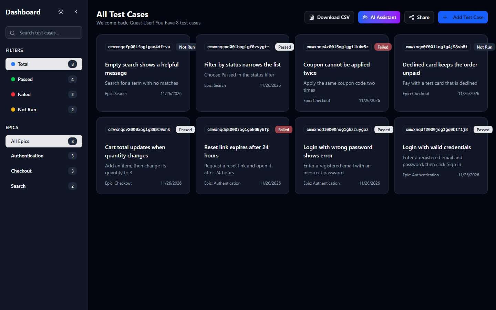
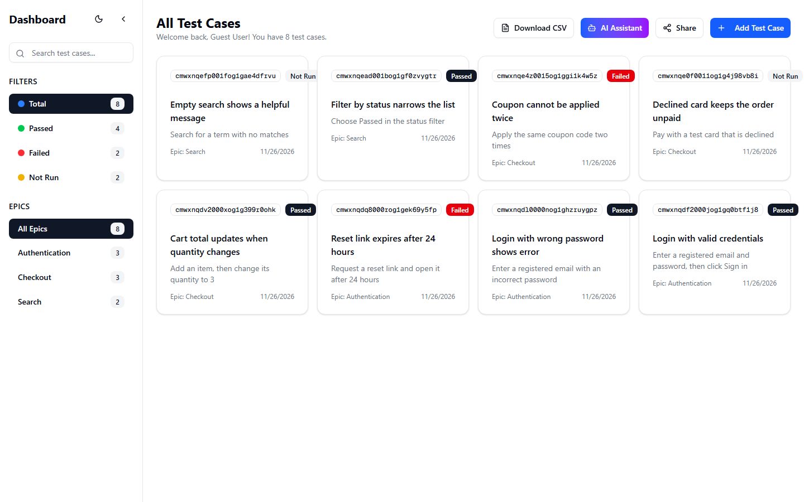
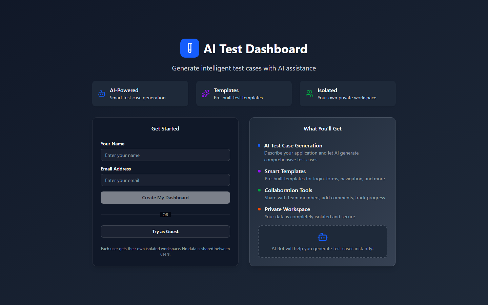

# 🧪 Test Case Management Dashboard

A clean, self-hosted dashboard for writing, organizing and tracking manual test cases, with an AI assistant that drafts test cases for you. Built with Next.js 15, React 19, Prisma and shadcn/ui.




<details>
<summary>More screenshots</summary>

**Light theme**



**Welcome screen**: start your own workspace or try it as a guest



</details>

## ✨ Features

- **Test cases by epic**: group cases (Authentication, Checkout, …) and filter by epic, status or text
- **Status tracking**: Passed / Failed / Not Run, with live counts in the sidebar
- **CSV import and export**: bring an existing spreadsheet in, take your suite out
- **AI assistant**: generate test cases from templates (login, forms, navigation, …); uses OpenAI when `OPENAI_API_KEY` is set
- **Comments and sharing**: discuss a case and share a dashboard with Owner / Editor / Viewer / Commentor roles
- **Dark and light themes**, collapsible sidebar, responsive layout
- **Audit log** of creates, updates and deletes

## 🚀 Quick start

**Prerequisites:** Node.js 18+ and a PostgreSQL database.

```bash
git clone https://github.com/Boyka-bob/test-case-management-dashboard.git
cd test-case-management-dashboard
npm install
cp environment.example .env
```

**1. Get a database.** Either run one locally with Docker (uses the `db` service from `docker-compose.dev.yml`):

```bash
docker compose -f docker-compose.dev.yml up -d db
```

…or create a free hosted PostgreSQL database (Neon, Supabase, Vercel Postgres) and paste its connection string into `DATABASE_URL` in `.env`.

**2. Create the tables and start the app.**

```bash
npx prisma db push
npm run dev
```

Open http://localhost:3000, click **Try as Guest**, and add your first test case. Default epics and AI templates are created automatically on first load.

## 📋 CSV import format

The **Add Test Case** dialog can download a sample CSV with every supported column. The minimum is:

```csv
Epic,ID,Description,Expected Result,Status,Notes
Authentication,TC1.1,User login with valid credentials,Successful login,Passed,Working as expected
Authentication,TC1.2,User login with invalid credentials,Error message displayed,Failed,Fix error styling
```

Re-importing a row with an existing ID updates it instead of creating a duplicate.

## 🔧 Configuration

| Variable | Required | Purpose |
|---|---|---|
| `DATABASE_URL` | Yes | PostgreSQL connection string |
| `NEXTAUTH_SECRET` | Yes | Any long random string |
| `NEXTAUTH_URL` | Yes | `http://localhost:3000` locally, your domain in production |
| `OPENAI_API_KEY` | No | Enables OpenAI-backed test generation in the AI assistant |

See [`environment.example`](environment.example) for the full list.

## 🌐 Deployment

The app deploys to Vercel as-is: import the repo, set the variables above, and point `DATABASE_URL` at a hosted PostgreSQL database. Docker (`Dockerfile`, `docker-compose.yml`) is included for self-hosting. Details: [DEPLOYMENT.md](DEPLOYMENT.md).

## ⚠️ Security note

Sign-in is a lightweight browser session (name + email, or guest) meant for demos and small trusted teams. It is not real authentication: the API trusts the user id the browser sends. Do not store sensitive data in a public deployment.

## 🧱 Tech stack

Next.js 15 (App Router, API routes) · React 19 · TypeScript · Tailwind CSS 4 · shadcn/ui · Prisma 6 · PostgreSQL

## 🗺️ Roadmap

- [ ] Real authentication (OAuth / email magic link)
- [ ] Reporting and run history
- [ ] Import from and export to popular test frameworks
- [ ] Attachments and screenshots as evidence

## 🤝 Contributing

Issues and pull requests are welcome. For larger changes, please open an issue first to discuss what you'd like to change.

## 🌟 Acknowledgments

[Next.js](https://nextjs.org/) · [shadcn/ui](https://ui.shadcn.com/) · [Lucide](https://lucide.dev/) · [Prisma](https://prisma.io/)

If this project saves you time, a ⭐ helps others find it.
